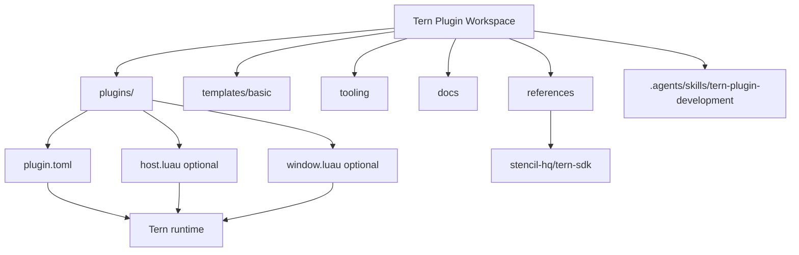

# 工作区设计

## 1. 目标

这个仓库承载多个自定义 Tern plugin。目标不是把它们编译成一个应用，而是提供：

- 可独立 `tern plugin link` 的插件目录；
- 统一的 Luau 类型检查和验证入口；
- 可追溯的官方 SDK、文档和示例索引；
- 可被 Agent 读取的项目级开发规范。

## 2. 推荐拓扑



## 3. 目录边界

### `plugins/`

唯一的交付单元目录。目录名默认与 manifest 的 `id` 相同。一个插件只维护自己的：

- `plugin.toml`
- `host.luau`、`window.luau`
- `lib/` 私有模块
- CSS、fixture、插件 README

不要在这里建立按 API 类型划分的全局目录，例如 `plugins/lenses/`、`plugins/blocks/`。插件的真实边界是可安装 package，不是某个 API 类型。

### `templates/`

新插件起点。模板必须保持最小，并且复制后能够通过 manifest 解析和基本加载检查。模板不被 Tern link，不作为实际插件发布。

### `tooling/`

工作区级工具，例如：

- 枚举所有 `plugins/*/plugin.toml`；
- 为每个插件生成 `tern.d.luau`；
- 执行 `luau-lsp analyze`；
- 检查插件 README、manifest id 和目录名是否一致。

工具不应被插件运行时 `require`。如果代码需要进入插件运行时，应放入对应插件的 `lib/`。

### `references/`

只放链接、版本基线和阅读指引。默认不复制 SDK 源码。若需要固定一份官方示例，优先使用 git submodule 或在文档中记录 commit，而不是无来源复制。

### `.agents/skills/`

只放本工作区特有的 Agent 约束。它应描述“如何在这里开发 Tern plugin”，而不是重新抄完整 API 文档。API 事实链接到官方文档。

## 4. 共享代码策略

Tern 的模块加载边界是插件目录内的相对 `require`。因此采用以下顺序：

1. 只复用一次：直接写在插件内。
2. 同一插件内复用：放到该插件的 `lib/`。
3. 多个插件都需要且接口稳定：先抽取为独立 Tern plugin 或独立生成/复制步骤，再评估版本管理。
4. 不直接让插件运行时依赖工作区根目录的 `shared/`。

这样可以避免 link、发布、远程 session 和插件信任边界因隐式路径依赖而失效。

## 5. 插件命名和生命周期

- `plugin.toml.id` 使用 Tern 规则：小写字母、数字和 `-`，以字母开头，最长 32 个字符。
- 一个目录只对应一个 plugin id。
- 开发时只 link 正在修改的插件；不要把整个 `plugins/` link 成一个插件。
- `tern.d.luau` 是生成产物。是否提交由团队决定；本工作区建议提交它，便于编辑器开箱即用，但升级 Tern 后必须重新生成并检查差异。
- 插件 README 至少说明：用途、Host/Window 半部、安装/link 命令、所需外部命令或权限。

## 6. 验证门槛

新增或修改插件后，按风险执行：

```sh
tern plugin types plugins/<plugin-id>
luau-lsp analyze \
  --platform=standard \
  --definitions=@tern=plugins/<plugin-id>/tern.d.luau \
  plugins/<plugin-id>/*.luau
tern plugin link "$PWD/plugins/<plugin-id>"
tern plugin list
```

真实运行检查至少覆盖：

- manifest 能被 Tern 解析；
- 插件能加载并出现在 `tern plugin list`；
- 入口所在半部的行为可在 Tern 中触发；
- 修改后 reload 能恢复；
- 失败 handler 的错误能在 toast/log 中定位。

## 7. 暂不引入的东西

- 不引入统一的跨插件运行时库；
- 不把官方 SDK 整个 vendoring 到仓库；
- 不为了“未来插件分类”提前增加多层目录；
- 不引入 Node/Bun 构建系统，除非某个实际插件或 tooling 需要它。
